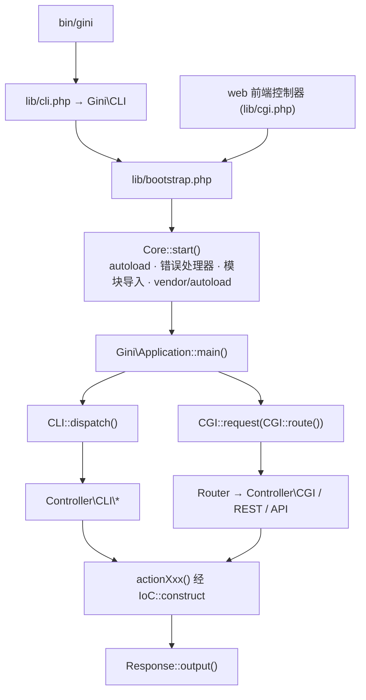

# 仓库指南（Repository Guidelines）

## 项目概览

Gini（`genee/gini`，v2.3.1，MIT）是一个受 Kohana、Symfony 与 Composer 启发的模块化 MVC PHP 框架。它既作为 Composer 库分发，也作为 CLI 工具（`bin/gini`）使用。应用由**松散耦合的模块**组成——任何包含 `gini.json` 的目录即是一个模块。框架自带 ORM（`Those`）、JSON-RPC/REST 服务端与客户端、DI 容器、事件系统、视图引擎与缓存生成器；外部运行时依赖极少（`sabre/dav`、`doctrine/inflector`、`doctrine/annotations`、`dragonmantank/cron-expression`）。

支持的 PHP 版本窗口：**`^7.4 || ^8.5`**——两个版本都必须保持全绿（见 `openspec/specs/dependency-contract/spec.md`）。

## 架构与数据流



**引导层** — `lib/bootstrap.php` 推导 `SYS_PATH` / `GINI_APP_PATH`（从 `$PWD` 向上查找 `gini.json`）/ `GINI_MODULE_BASE_PATH`，把 `cache/class_map.json` 与 `cache/view_map.json` 载入 `$GLOBALS`，随后调用 `Core::start()`：注册 autoload/error/exception 处理器，定义 `CLASS_DIR`/`VIEW_DIR`/`RAW_DIR`/`DATA_DIR`/`CACHE_DIR`，按依赖顺序导入模块（`Core::import`），若存在则加载 `APP_PATH/vendor/autoload.php`，执行 `Config::setup()`/`Event::setup()`，最后**仅在 class map 存在时**调用各模块类的 `setup()` 钩子。

**两个入口行为不同**：`lib/cli.php` 较宽松（无 class map 时 autoload 回退到目录扫描）；`lib/cgi.php` 定义了 `GINI_MUST_CACHE_AUTOLOAD`，缺少 `cache/class_map.json` 会直接中止——因此为 Web 应用新增类/视图/路由后，必须执行 `bin/gini cache`。

**分发** — 四类控制器共享同一条模板方法链（`middleware → __preAction → action → __postAction`，`class/Gini/Controller/CGI.php:114`）：

| 控制器 | 基类 | Action 命名 | 参数注入 |
|---|---|---|---|
| CGI | `Controller\CGI` | `actionXxx`，缺省 `__index`，找不到抛 404 `Response\Exception` | `CGI::functionArguments()` 反射：数字 key 按位置、字符串 key 按参数名驼峰归一化后与 form 合并 |
| REST | `Controller\REST extends CGI` | `<method><Action>`（`getUser`、`postDefault`） | 同上 |
| API（JSON-RPC） | `Controller\API` | `a.b.c` → `\Gini\Controller\API\A\B::actionC` | 同上 |
| CLI | `Controller\CLI` | `actionXxx`（剥离 `-`/`_`），兜底 `__index` → `__unknown` | 整包 `$params` 数组作为单个参数传入 |

**ORM 数据流** — `those('users')` → 链式条件（`whose()->isIn()/contains()/…`，`Those\Whose`）→ 组合器（`meet/anyOf/allOf/whoAre`）→ `makeSQL()` 生成 `SELECT DISTINCT …` 与 count SQL 字符串 → 惰性 `fetch()` 经 `Database::query()` 执行 → `ORMIterator`（Iterator/ArrayAccess/Countable）。`a('user', $criteria)` 等价于 `IoC::construct('\Gini\ORM\user', $criteria)`。`Database` 是 PDO 门面，支持 `@ident` 占位符与**嵌套计数式事务**（`beginTransaction/commit/rollback` 只在最外层真正下发）。

## 关键目录

| 路径 | 用途 |
|---|---|
| `class/Gini/` | 全部框架源码（114 个文件）。根级类构成基础设施（`Core`、`Config`、`Event`、`IoC`、`ORM`、`Those`、`Database`、`CLI`、`CGI`、`HTTP`、`RPC`、`REST`、`API`、`Logger`、`Session`、`View`、`I18N`、`Util`、`File`、`URI`）；子目录按子系统分组（`Database/`、`Those/`、`CGI/`、`Controller/`、`Document/`、`Logger/`、`PHPUnit/`、`Session/`、`Lock/`、`App/`、`Module/`、`View/`、`Helper/`） |
| `lib/` | `bootstrap.php`（共享）、`cli.php`、`cgi.php`——三层引导入口 |
| `bin/gini` | CLI 入口 shim（`require lib/cli.php`） |
| `ci/` | `test/`（PHPUnit 套件）、`bootstrap.php`（测试专用预加载）、`dual-test.sh`（权威测试门槛） |
| `raw/` | 随包分发的静态/配置**源**：`config/*.yml`（由 `Config` 合并）、`config/@<env>/` 环境覆盖层（生成物，已 gitignore）、`assets/`、`l10n/`、`templates/phpunit/` |
| `data/` | 仅部署脚本：`gini.sh`（导出路径变量）、`gini-completion.bash` |
| `cache/` | **生成物，已 gitignore**：`class_map.json`、`view_map.json`、`config.json`、`router.json`（存绝对路径——换挂载路径后必须重建） |
| `openspec/` | 规格驱动变更记录：`specs/` = 生效中的行为契约，`changes/archive/` = 历史 |
| `vendor7/ vendor8/ vendor81/ vendor85/` | 按 PHP 版本准备的依赖树（见「运行时与工具」）。禁止提交；仅在容器内映射为 `vendor/` |

## 开发命令

宿主机**没有 PHP 与 Composer**——一切都在 Docker 中执行（镜像为 amd64，arm64 主机上会打印无害的 platform warning）。

```sh
# 权威门槛：PHP 7.4 与 8.5 双版本全量（自动清理符号链接与 class_map）
ci/dual-test.sh

# 单版本全量
docker run --rm -v "$PWD":/app -w /app docker.genee.cn/php:8.5-alpine \
  sh -c 'ln -sfn vendor85 vendor && vendor85/bin/phpunit'

# 单文件 / 单用例（PHPUnit CLI 只认第一个位置参数为路径）
docker run --rm -v "$PWD":/app -w /app docker.genee.cn/php:8.5-alpine \
  sh -c 'ln -sfn vendor85 vendor && vendor85/bin/phpunit ci/test/Core/I18N.php'
# … --filter testTInterpolatesParams ci/test/Core/I18N.php
# … --order-by=random --random-order-seed=42

# 手工执行过 ln -sfn 后必须清理
rm -f vendor cache/class_map.json

# 语法检查（对应 CI 中唯一的 lint）
docker run --rm -v "$PWD":/app -w /app docker.genee.cn/php:7.4-alpine \
  sh -c 'find class lib ci bin -name "*.php" -print0 | xargs -0 -n1 php -l'

# 重建缓存（新增类/视图/路由后必须；CGI 缺 class_map 会中止）
docker run --rm -v "$PWD":/app -w /app docker.genee.cn/php:7.4-alpine sh -c 'bin/gini cache'

# 由 gini.json 重新生成 composer.json（后者是构建产物）
docker run --rm -v "$PWD":/app -w /app docker.genee.cn/php:7.4-alpine sh -c 'bin/gini composer init -f'
```

## 代码约定与常见模式

- **格式**：4 空格缩进；类与函数的左大括号另起一行；`elseif`。全仓无 `declare(strict_types)`。历史风格被容忍——改动时与周围代码保持一致。
- **命名**：文件/类用 `PascalCase` 且与命名空间一致（`class/Gini/CGI/Router.php` → `Gini\CGI\Router`）；方法 `camelCase` 动词短语（`fetchModuleInfo`、`makeSQL`）；私有/受保护成员常用 `_` 前缀（`$_where`）；常量 `UPPER_SNAKE`；控制器 action 一律 `actionXxx`；框架钩子用双下划线（`__index`、`__unknown`、`__preAction`、`__postAction`）。
- **全局辅助函数寄生在类文件尾部的 `namespace { }` 块中**——`_G/s/H/J/V`（`Core.php`）、`a/an`（`ORM.php`）、`those/whose/anyOf/allOf/whoAre`（`Those.php`）、`T`（`I18N.php`）、`SQL`（`Database.php`）、`URL`（`URI.php`）。每个都以 `function_exists()` + `die(...)` 守卫防止冲突。**后果**：辅助函数只在对应类文件被加载后才存在——测试必须预加载（`ci/bootstrap.php`），新增此类函数也要同步预加载。
- **错误处理**：`Core::error()` 把未被抑制的错误转成 `ErrorException`；`E_DEPRECATED | E_USER_DEPRECATED` 只记录日志（`Logger::of('core')->debug()`），**永不升级为异常**。`@` 抑制靠掩码判定（`!(error_reporting() & $errno)`），而非 `error_reporting() === 0`。预期内的 HTTP 失败抛 `\Gini\CGI\Response\Exception($msg, $statusCode)`（code 即 HTTP 状态）；纯诊断问题倾向 `Logger` + `return false`。
- **依赖注入**：所有对象都经 `\Gini\IoC::construct($class, ...$args)` 构造；可用 `IoC::bind/singleton/instance/clear` 覆盖（key 为小写类名）。控制器、模块、DB 驱动、视图引擎、日志 handler、REST 客户端全部走这条路——这也是测试替换假实现的方式。
- **状态**：点号路径分层配置（`\Gini\Config::get('app.debug')`），层级为 `raw/config/*.yml` → `config/@<env>/` 覆盖 → `cache/config.json`；事件用 `Event::bind/trigger`（ORM 暴露 `orm[user].call[method]` 形式的事件名）；模块注册表在 `Core::$MODULE_INFO` + `$GLOBALS['gini.class_map']`；`Those` 维护静态别名计数器——构造查询断言之间要调用 `\Gini\Those::reset()`。
- **异步**：不存在。请求/响应模型完全同步。唯一的并发是 `gini cron run` 中的 `pcntl_fork`，以及 `@app` / `sh` 重入用的 `proc_open`。
- **魔术方法是承重结构**：ORM `__get/__set`（惰性 fetch + 关联/字段分派）、`__call`（事件代理）、`Those::__call`（条件代理）、`Router/REST/Prototype/Database::__call`（动词/驱动透传）。ORM 类带 `#[\AllowDynamicProperties]`。
- **ORM 字段 DSL** 是写在 public 属性上的字符串微语言：`public $id = 'bigint,primary,serial'`、`'string:50'`、`array`、`object:<name>`、`many:user,object:user`、`via:<table/field>`。

## 重要文件

| 文件 | 角色 |
|---|---|
| `gini.json` | **唯一权威源**：模块元数据、`composer` require 段、`dependencies`、`moduleClass`。改这里，然后重新生成 |
| `composer.json` / `composer.lock` | 生成物 / 版本锁定产物（均已 gitignore；但 `composer.json` 当前被 git 跟踪——不要手改） |
| `lib/bootstrap.php` | 共享引导；**生产入口——绝不为了可测性修改它** |
| `lib/cli.php`、`lib/cgi.php` | CLI / Web 应用适配层 |
| `class/Gini/Core.php` | Autoload、模块导入、错误/异常策略、`start()` |
| `class/Gini/CLI.php` | 命令发现与分发（`@app` 前缀、`-v/-h/--/root`） |
| `class/Gini/CGI.php` | 请求组装、路由桥接、`functionArguments()` 反射 |
| `phpunit.xml` | bootstrap `./ci/bootstrap.php`，套件 `./ci/test`，覆盖率范围 `class/` |
| `ci/bootstrap.php` | 测试专用引导：`lib/bootstrap.php` + 预加载 `ORM.php`/`Those.php`/`I18N.php` 的全局函数块 |
| `ci/dual-test.sh` | 唯一获准的回归入口（见「运行时与工具」） |
| `openspec/specs/*/spec.md` | 生效中的契约——改动错误处理、依赖契约或测试基建前先读 |
| `class/Gini/Controller/CLI/*.php` | 内置命令；此处任何类都会被 `bin/gini -h` 自动发现 |

常用 `bin/gini` 命令：`cache [clean]`、`composer init -f`、`app {modules,info,doctor,init,install}`、`orm {update,export}`（先跑 `cache`）、`doc {api,cli,cgi,openapi,openrpc}`、`ci phpunit create <Class/For/Test>`、`web {update,preview,clean}`、`config {export,env,merge-env}`、`cron {list,run,schedule}`、`i18n {scan,format,test}`、`ide vscode`、`suite <cmd>`、`cgi request <URL>`。

## 运行时与工具偏好

- **PHP 窗口 `^7.4 || ^8.5`** 在 `gini.json` 中声明；两个版本必须同时通过。PHP 8.5 的弃用告警由错误处理策略集中处理——不要局部压制。
- **Docker 镜像** `docker.genee.cn/php:7.4-alpine` / `php:8.5-alpine` 是唯一可用运行时。宿主机无 PHP/Composer。
- **依赖树按版本分目录**（`vendor7`、`vendor85`，以及遗留的 `vendor8`/`vendor81`），通过**容器内创建的临时符号链接**映射到硬编码的运行路径 `vendor/`（见 `Core.php`：`APP_PATH/vendor/autoload.php`）。绝不要创建真实的 `vendor/` 目录——`ci/dual-test.sh` 检测到实体目录会拒绝运行。
- **不要在仓库内直接 `composer install` 来"先装上依赖"**：清单是生成物、lock 被 gitignore，且 platform check 会拒绝 PHP 8.0–8.4。
- **CI**（`.drone.yml`，镜像 `genee/gini-dev:alpine`）依次执行：`class/`+`view/` 的 `php -l` → `bin/gini composer init -f` → `composer install --no-dev` → `bin/gini cache` → `phpunit`。它仍只跑 PHP 7——双版本门槛靠本地 `ci/dual-test.sh`。
- **已废弃的工具配置**：`phpdoc.xml`（phpDocumentor v1 语法）、`phpspec.yml`（容器绝对路径）、`sonar-project.properties`（引用的 `tests/` 目录不存在）均已陈旧；`.php_cs.cache`/`.php-cs-fixer.cache` 是缓存而非规则文件——没有可遵循的格式化配置。

## 测试与质量保证

- **框架**：PHPUnit 9.x（7.4 下 9.5.21 / 8.5 下 9.6.38）。套件：42 个文件、270 tests、1131 assertions——不需要数据库或网络，所有外部依赖都被 mock 或经 IoC 替换。
- **布局**：`ci/test/<子系统>/<X>.php` → `namespace Gini\PHPUnit\<子系统>; class <X>`。夹具放在同文件内：要么是同级类，要么当夹具必须注册进生产命名空间时用第二个花括号 namespace（如 `ci/test/CGI/General.php` 声明了 `Gini\Controller\CGI\Hello`）。
- **基类**（`class/Gini/PHPUnit/TestCase/`）：`Unit`——零副作用，用于纯逻辑；`CLI`——调用 `CLI::setup()`（URI/Session/Env），凡触及 `a()`、`those()`、ORM 或全局配置都用它；`CGI`——`CGI::setup()` 变体。
- **Mock 方式**：`use MockDatabase;`（`class/Gini/PHPUnit/MockDatabase.php`）提供 `createDatabaseMock()`、`attachQueryHandler($db, $result, ?callable $recorder)`、`bindIoC($key, $factory)`、`clearMockIoC()`。断言 `makeSQL()`/`$those->SQL()` 产出的**完整 SQL 字符串**；用 `Statement::row` mock 驱动结果游标（先返回数据行，最后返回 `[]`）。
- **任何测试改动的验收门槛**：`ci/dual-test.sh` 双版本全绿、新文件单跑全绿、`--order-by=random` 全绿（顺序无关是契约要求）。
- **坑（均在仓库内实测过）**：全局辅助函数需在 `ci/bootstrap.php` 预加载；全局状态（`Config`、`Those::reset()`、`IoC::clear`）必须在 `tearDown` 还原；测试类不要与 PHP 内建类同名（`Error` → `ErrorHandler` 的历史教训）；PHPUnit 只把第一个位置参数当路径；生成的 mock 类名需唯一。
- **覆盖率**：`phpunit.xml` 把覆盖率范围限定为 `class/` 且 `includeUncoveredFiles="true"`。没有强制阈值；质量以真实行为断言衡量，而非行覆盖率（见 `openspec/specs/unit-test-infrastructure/spec.md`）。
- **行为契约**：改动错误处理、依赖或测试基建前先查 `openspec/specs/`；较大的工作遵循 OpenSpec 流程（`openspec list` → 提案 → 审查 → 实现 → `openspec archive`）。
